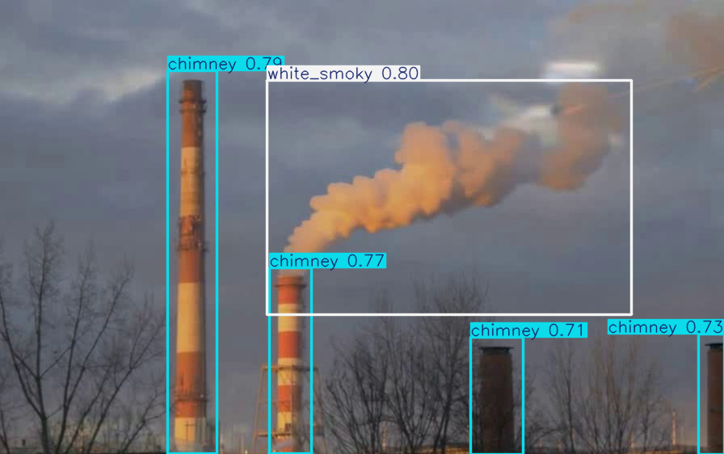
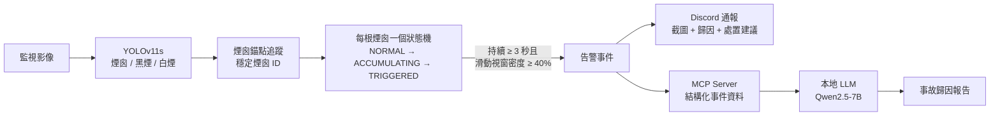

# 石化園區煙囪排煙 AI 監控系統

> 國立成功大學 資訊工程學系 畢業專題（個人獨立完成）

用 YOLOv11 即時偵測煙囪的黑煙與白煙，再經過時序狀態機過濾單幀誤判，確認是持續性的異常排煙才發出告警。告警會附上截圖推送到 Discord，並由本地 LLM（Ollama + Qwen2.5-7B）透過 MCP 協定讀取結構化事件資料，自動生成事故歸因報告。



延伸研究：專題完成後，我針對「LLM 生成的事故報告是否忠實」做了進一步的實驗與論文，見 **[chimney-monitor-llm-faithfulness](https://github.com/JustinWen026/chimney-monitor-llm-faithfulness)**。

---

## 系統架構



## 主要功能

- **煙霧偵測**：YOLOv11s 偵測 `chimney`、`black_smoky`、`white_smoky` 三類。
- **時序狀態機**：煙霧要持續超過 3 秒，而且過去 5 秒的偵測命中率超過 40%，才會觸發告警，避免單幀誤判造成誤報（滑動視窗密度的做法參考 Park & Ko, 2020）。
- **多煙囪事件歸屬**：
  - 以 x 座標錨點分群穩定煙囪 ID，YOLO 偶爾漏偵也不會讓 ID 跳動。
  - 以 Temporal Onset Priority 處理相鄰煙囪的煙霧在畫面上合併的情況：同一時間只鎖定一個事件源。
- **非同步告警**：Discord 通報在背景執行緒送出，不阻塞推論迴圈。通報內容包含截圖、煙霧類型、持續時間、密度、信心度、歸因與建議處置。
- **LLM 事故報告**：告警觸發後，LLM 透過 MCP 工具取得結構化事件資料再撰寫報告，不直接讀取雜亂的原始系統日誌。

## 成果

### 1. 偵測模型

| 版本 | 模型 | 輸入尺寸 | Epochs | Precision | Recall | mAP50 | mAP50-95 |
|---|---|---|---|---|---|---|---|
| v1 | YOLOv11n | 640 | 3 | 0.670 | 0.653 | 0.673 | 0.322 |
| **v2** | **YOLOv11s** | **1024** | **158（early stop，best = 108）** | **0.799** | **0.756** | **0.805** | **0.506** |

v1 與 v2 使用的驗證集切分不同：v1 是 Roboflow 原始切分，v2 是我自己重新做的 8:2 切分，所以上表只能看出整體趨勢，不是嚴格的同一基準比較。訓練曲線與混淆矩陣放在 [`results/v1`](results/v1) 與 [`results/v2`](results/v2)。

專題起點是先拿 COCO 預訓練模型直接推論。結果它完全認不出煙霧，只在信心度 0.01–0.06 之間誤判出 traffic light、person、train 等類別（[`results/v1/baseline_coco_inference.png`](results/v1/baseline_coco_inference.png)），這也是後來自己訓練模型的原因。

### 2. 結構化輸入 vs. 原始日誌（LLM 報告消融實驗）

這組實驗比較 LLM 寫事故報告時的兩種輸入。兩組使用同一個模型（`qwen2.5:7b-instruct`）、同一筆真實偵測事件，每組各跑 N=30 次，執行順序隨機，正式開始前先熱身。

- **Baseline**：輸入是後台原始日誌，裡面混有無關雜訊，例如其他時間戳、email、FPS 數值。
- **MCP**：輸入是經 MCP 工具過濾後的結構化 JSON，並要求依五段式格式輸出。

| 指標 | Baseline | MCP |
|---|---|---|
| 雜訊引用率（輸出中出現日誌雜訊字眼的比例） | 8.5% ± 8.6% | **0.0%** |
| 格式合規率（五段式報告，加權深度評分） | 42.7% ± 14.4% | **100%** |
| 總生成時間 | 7.30 ± 1.05 s | 8.07 ± 0.49 s |
| 首字延遲 TTFT | 2.24 s | 2.24 s |

（`ablation_study.py` v6 設計，temperature 0.3，原始數據見 [`results/ablation_results_v6.json`](results/ablation_results_v6.json)）

## 版本歷程

| 階段 | 時間 | 內容 |
|---|---|---|
| **v1.0** | 2026/03–04 | 驗證可行性：COCO 預訓練模型 baseline → YOLOv11n 微調（3 類，3 epochs） |
| v2 模型 | 2026/04 | 改用 YOLOv11s、imgsz 1024、8:2 切分，early stopping 訓練 |
| v2 時序邏輯 | 2026/06 | 狀態機 → 多煙囪 FSM + 滑動視窗 → 錨點追蹤 → Event-Locking → Temporal Onset Priority |
| v2 告警 | 2026/06 | Discord Webhook 非同步通報，附截圖與歸因建議 |
| v2 LLM | 2026/06 | MCP Server + Ollama 事故報告，消融實驗 v1 → v6 |

> **關於 commit 歷史：** 開發期間我沒有使用 git，而是用 `xxx_v2.py`、`xxx_v3.py` 這種檔名保存每個版本。上傳 GitHub 時，我把這些版本檔依實際修改時間依序重建成 commit，作者時間就是檔案當時的修改時間。每個 commit 對應一個真實存在過的版本，可以用 `git log` 逐版查看演進過程，例如 `git log -p mvp_detector_visual_edge.py`。

## 安裝與執行

環境：Python 3.10、NVIDIA GPU（開發時使用 RTX 5060）。

```bash
git clone https://github.com/JustinWen026/chimney-monitor-capstone.git
cd chimney-monitor-capstone
pip install -r requirements.txt
```

**即時偵測 Demo**（使用 `assets/` 的測試影片與 `weights/best.pt`）：

```bash
# 可選：設定 Discord Webhook，沒設定時會略過通報
set DISCORD_WEBHOOK_URL=https://discord.com/api/webhooks/...   # Windows
export DISCORD_WEBHOOK_URL=https://discord.com/api/webhooks/... # macOS / Linux

python mvp_detector_visual_edge.py
```

**LLM 報告與消融實驗**（需先安裝 [Ollama](https://ollama.com) 並下載模型）：

```bash
ollama pull qwen2.5:7b-instruct
python ablation_study.py
```

**重新訓練模型**：從 Roboflow 下載資料集（YOLOv11 格式），把 `train/`、`valid/` 放進 `datasets/` 之後：

```bash
python train_smoke.py
```

## 專案結構

```
├── mvp_detector_visual_edge.py   # 主程式：YOLO 推論 + 錨點追蹤 + 多煙囪狀態機 + 告警
├── discord_notifier.py           # Discord 非同步告警（含截圖上傳）
├── mcp_server.py                 # MCP Server：提供結構化事件資料給 LLM
├── run_mcp_agent.py              # LLM 歸因代理（原始日誌 vs. MCP 對比）
├── ablation_study.py             # LLM 報告消融實驗
├── train_smoke.py                # YOLOv11s 訓練
├── compare_smoke.py              # v1：COCO 預訓練模型 baseline 推論
├── test_alert_pro.py             # 單張圖片告警測試，產生 email 預覽頁
├── make_perfect_video.py         # 測試影片合成
├── crop_video.py                 # 測試影片裁切
├── datasets/data.yaml            # 資料集設定（影像需另外下載）
├── weights/best.pt               # v2 訓練好的權重
├── assets/                       # 測試影片與圖片
└── results/                      # 訓練結果、消融實驗數據、LLM 報告範例
```

## 已知限制

- 測試影片是用 AI 影片生成工具合成的，不是實際廠區監視器畫面。
- 煙霧類型對應歸因（黑煙 → 燃燒控制異常、白煙 → 製程洩漏）是規則式對照表，不是模型推論出來的。

## 開發工具

程式開發與文件撰寫過程中，使用 Claude（Anthropic）作為輔助工具。

## 資料集與授權

- 原始資料集：[chimney (Roboflow Universe)](https://universe.roboflow.com/factory-cvi84/chimney-l1vf2)，CC BY 4.0
- v2 重新切分版本：[chimney-l1vf2-wvsig](https://universe.roboflow.com/justins-workspace-3mnwz/chimney-l1vf2-wvsig/dataset/1)，CC BY 4.0
